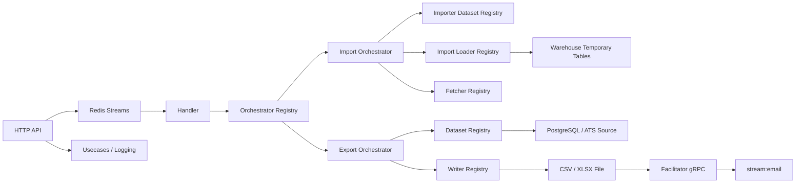
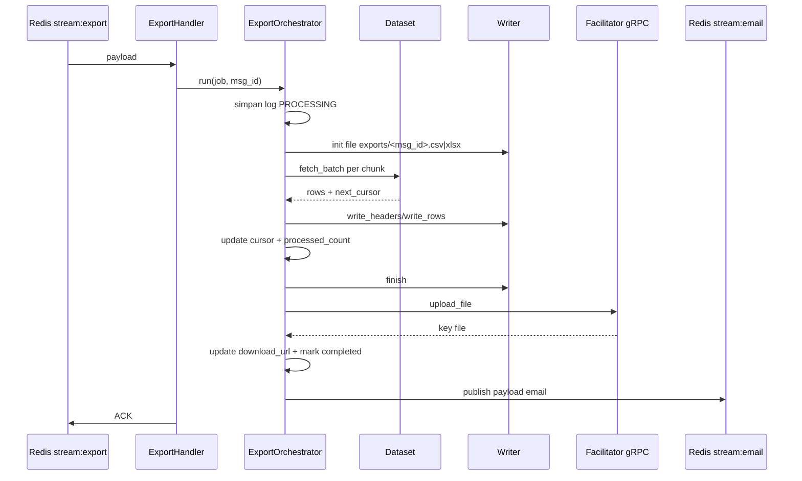
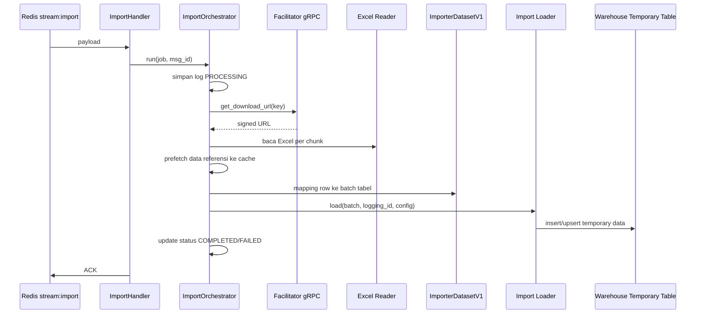

# Worker Exporter

Dokumen ini menjelaskan arsitektur dan cara penggunaan `worker-exporter` berdasarkan kondisi kode saat ini, bukan desain ideal.

## Ringkasan

`worker-exporter` adalah service Rust berbasis worker yang memproses job asynchronous melalui Redis Stream. Saat ini jalur yang paling nyata dipakai adalah:

- `IMPORT`: ambil file Excel dari storage, parsing per chunk, mapping ke dataset import, lalu simpan ke tabel temporary warehouse.
- `EXPORT`: ambil data dataset dari database, tulis ke file CSV/XLSX, upload file ke facilitator gRPC, lalu publish event email.
- `HTTP`: endpoint bantu untuk publish job import, ambil log, buat template import, dan redirect file hasil.

Walau ada istilah `ingestion` di beberapa modul, implementasi aktif di binary worker saat ini fokus ke `IMPORT` dan `EXPORT`.

## Status Implementasi Saat Ini

Status nyata repo:

- `cargo check` lolos.
- Masih ada banyak warning dan sebagian modul masih placeholder.
- Worker aktif membuat consumer group untuk `stream:ingestion`, `stream:export`, dan `stream:import`.
- Worker yang benar-benar di-spawn saat runtime hanya consumer `EXPORT` dan `IMPORT`.
- `PipelineRegistry` untuk ingestion/export lama masih kosong, jadi sebagian desain lama belum benar-benar dipakai.

Kesimpulan singkat:

- Repo ini sudah bisa disebut worker import/export.
- Repo ini belum rapi penuh sebagai platform ingestion generik atau OLAP matang.

## Gambaran Arsitektur



## Layer Utama

### 1. Entry Point

- `src/bin/worker.rs`
  Menjalankan worker Redis Stream. Membuat consumer group dan men-spawn:
  - 3 worker `EXPORT`
  - 3 worker `IMPORT`
- `src/bin/http.rs`
  Menjalankan API HTTP berbasis Axum.
- `src/main.rs`
  Ada bootstrap dasar, tapi bukan jalur utama yang dipakai oleh Dockerfile.

### 2. Bootstrap dan AppState

File inti:

- `src/boostrap.rs`
- `src/app_state.rs`

Tanggung jawab:

- baca env config
- buka koneksi Redis
- buka pool PostgreSQL
- bangun gRPC client
- register dataset, writer, loader, fetcher, orchestrator
- simpan dependency ke `AppState`

`AppState` memegang:

- `orchestrator_registry`
- `grpc_service`
- `publisher`
- `manager` Redis
- `usecases`

### 3. Application Layer

Folder utama: `src/application`

Komponen penting:

- `handler/`
  Loop consume Redis, deserialize payload, panggil orchestrator, lalu `ACK`.
- `orchestrator/`
  Koordinator flow `IMPORT` dan `EXPORT`.
- `dataset.rs`
  Registry dataset export dan import.
- `loader_registry.rs`
  Registry loader incremental warehouse.
- `import/import_registry.rs`
  Registry loader untuk proses import ke tabel temporary.
- `writter.rs`
  Registry writer `csv` dan `excel`.
- `fetch_source_regitry.rs`
  Registry fetcher referensi/master data.
- `usecases/`
  Use case HTTP seperti list log dan generate template.

### 4. Core Layer

Folder utama: `src/core`

Kontrak penting:

- `Consumer`
  Kontrak consume dan ack message Redis.
- `Orchestrator`
  Kontrak `run(job, msg_id)`.
- `Dataset`
  Kontrak export batch.
- `ImporterDatasetV1`
  Kontrak mapping row Excel menjadi struktur tabel import.
- `ImportLoadPersitence`
  Kontrak simpan batch hasil import.
- `WritterTrait`
  Kontrak writer file export.

Layer ini jadi fondasi supaya source, dataset, loader, dan writer bisa diganti lewat registry.

### 5. Infrastructure Layer

Folder utama: `src/infrastructure`

Komponen nyata yang aktif:

- `redis.rs`
  Implementasi consumer dan publisher Redis Stream.
- `exporter/csv_exporter.rs`
  Writer CSV berbasis `csv::Writer`.
- `exporter/excel_exporter.rs`
  Writer XLSX berbasis `excelstream`.
- `loader/warehouse/logging_warehouse.rs`
  Penyimpanan status job ke tabel `loggings`.
- `loader/warehouse/temporary/...`
  Loader import ke tabel temporary warehouse.
- `datasets/export/ats/lsi_candidate_dataset.rs`
  Dataset export kandidat ATS.
- `datasets/import/...`
  Mapping row Excel ke struktur import.
- `ingestion/...`
  Source/fetcher dari ATS, master, HRIS, dan organization.

### 6. Domain Layer

Folder utama: `src/domain`

Yang paling nyata dipakai saat ini:

- `domain/logging`
  Entity dan contract repo untuk status job.

## Alur Runtime Aktual

### Flow Export



Catatan:

- Format writer yang terdaftar: `csv`, `excel`.
- File sementara export disimpan di folder `exports/`.
- Dataset export yang terdaftar saat ini: `lsi_ats_candidate_dataset`.

### Flow Import



Catatan:

- Dataset import V1 yang terdaftar:
  - `DYNAMIC_DATASET_V1`
  - `LSI_IMPORT_VACANCY_V1`
- Loader import yang terdaftar:
  - `warehouse_ats_vacancy_temporary`
  - `WAREHOUSE_DYNAMIC_TEMPORARY_LOADER`
- Pipeline import yang terdaftar:
  - `vacancy_import_pipeline`

### Flow Ingestion

Secara desain, repo masih punya jejak flow ingestion:

- ada `IngestionHandler`
- ada `stream:ingestion`
- ada `SourceRegistry`
- ada `LoaderRunner`

Namun pada runtime worker saat ini:

- consumer `ingestion` tidak di-spawn
- orchestrator `INGESTION` tidak diregister
- `PipelineRegistry` masih kosong

Jadi `ingestion` sekarang lebih tepat disebut desain parsial, belum flow aktif end-to-end.

## Registry yang Aktif

### Orchestrator

- `IMPORT`
- `EXPORT`

### Writer

- `csv`
- `excel`

### Export Dataset

- `lsi_ats_candidate_dataset`

### Import Dataset V1

- `DYNAMIC_DATASET_V1`
- `LSI_IMPORT_VACANCY_V1`

### Import Loader

- `warehouse_ats_vacancy_temporary`
- `WAREHOUSE_DYNAMIC_TEMPORARY_LOADER`

### Fetcher Referensi

Contoh yang aktif:

- `MASTER_GEO`
- `MASTER_ITEMS`
- `EMPLOYEE`
- `EMPLOYMENT_STATUS`
- `JOB_POSITION`
- `JOB_GRADE`
- `JOB_LEVEL`
- `ORGANIZATION`
- `ATTEDANCE_LOCATION`
- beberapa fetcher ATS candidate/vacancy/education/experience

## Dependensi Eksternal

Service ini butuh:

- Redis
- PostgreSQL warehouse
- PostgreSQL organization
- PostgreSQL ATS
- PostgreSQL master
- PostgreSQL HRIS
- Facilitator gRPC
- ATS decryptor gRPC

## Environment Variable

Variable yang wajib untuk bootstrap:

- `WAREHOUSE_DATABASE_URL`
- `ORGANIZATION_DATABASE_URL`
- `MASTER_DATABASE_URL`
- `ATS_DATABASE_URL`
- `HRIS_DATABASE_URL`
- `REDIS_URL`
- `FACILITATOR_GRPC_URL`
- `ATS_GRPC_URL`

Variable opsional:

- `HOST` default `0.0.0.0`
- `PORT` default `8080`

## Struktur Folder Penting

```text
src/
  application/
    handler/
    orchestrator/
    presentation/http/
    usecases/
  core/
    config/
    traits/
  domain/
    logging/
  infrastructure/
    datasets/
    exporter/
    ingestion/
    loader/
    redis.rs
  bin/
    worker.rs
    http.rs
migrations/
Dockerfile
docker-compose.yml
Makefile.toml
```

## Cara Menjalankan

### Opsi 1: Local dengan Cargo

1. Siapkan env file atau export semua variable wajib.
2. Jalankan migration warehouse jika perlu.
3. Jalankan HTTP API.
4. Jalankan worker.

Contoh:

```bash
cargo make migrate-main
cargo run --bin http
```

Terminal lain:

```bash
cargo run --bin worker
```

### Opsi 2: Docker Compose

`docker-compose.yml` menyiapkan:

- `redis-dev`
- `worker-exporter-http`
- `worker-exporter-consumer`

Jalankan:

```bash
docker compose up --build
```

Catatan:

- service HTTP expose port `9090:8089`
- nilai port final tetap ikut `PORT` dari `.env.production`

## Cara Menggunakan

### 1. Publish Job Import via HTTP

Endpoint:

- `POST /test-import`

Contoh payload import:

```json
{
  "tenant_id": "019e95a5-f5f3-7dd8-952b-0ce16845d9bd",
  "email": "user@example.com",
  "actor_id": "actor-1",
  "orchestrator_name": "import",
  "export_config": null,
  "ingestion_config": null,
  "import_config": {
    "tenant_id": "019e95a5-f5f3-7dd8-952b-0ce16845d9bd",
    "group_id": "019e95a5-f5f3-7dd8-952b-0ce16845d9bd",
    "dataset": "LSI_IMPORT_VACANCY_V1",
    "key": "v6/HRMS/.../template_excel.xlsx",
    "data_source_type": "stream",
    "pipeline": "vacancy_import_pipeline",
    "loader": "WAREHOUSE_DYNAMIC_TEMPORARY_LOADER",
    "master_table": "vacancy",
    "primary_column": "id",
    "chunk": 500,
    "sequential_table": [
      {
        "table": "vacancy_pics",
        "is_custom": false,
        "fk_column": "vacancy_id"
      }
    ],
    "fetcher_caching": [],
    "fields": [
      {
        "header": "position_name",
        "column": "vacancy.job_position_id|vacancy.job_position_meta",
        "fetcher": "JOB_POSITION",
        "type_data": "UUID",
        "is_custom": false
      }
    ]
  },
  "filters": []
}
```

Contoh request:

```bash
curl -X POST http://127.0.0.1:8080/test-import \
  -H 'content-type: application/json' \
  -d @import-job.json
```

### 2. Publish Job Export via Redis

Saat ini repo punya endpoint HTTP publish import, tapi belum ada endpoint publish export. Jalur export praktis dilakukan langsung ke Redis stream.

Contoh payload export:

```json
{
  "tenant_id": "019e95a5-f5f3-7dd8-952b-0ce16845d9bd",
  "email": "user@example.com",
  "actor_id": "actor-1",
  "orchestrator_name": "export",
  "export_config": {
    "dataset": "lsi_ats_candidate_dataset",
    "format": "csv",
    "template_code": "LSI_EMAIL_EXPORT",
    "structure_template_code": "LSI_EXPORT_STRUCTURE",
    "redirected_url": "https://example.com/download?url={{url}}",
    "chunk": 1000,
    "fields": [
      { "name": "Candidate ID", "column": "candidate_id" },
      { "name": "Name", "column": "name" },
      { "name": "Email", "column": "email_address" }
    ]
  },
  "ingestion_config": null,
  "import_config": null,
  "filters": []
}
```

Contoh publish:

```bash
redis-cli -u "$REDIS_URL" XADD stream:export '*' payload "$(cat export-job.json)"
```

Hasil export:

1. Worker membuat file lokal di `exports/`.
2. File di-upload ke facilitator gRPC.
3. `download_url` disimpan ke tabel `loggings`.
4. Event email dipublish ke `stream:email`.

### 3. Ambil Log Job

Endpoint:

- `POST /loggings`

Payload:

```json
{
  "tenant_id": "019e95a5-f5f3-7dd8-952b-0ce16845d9bd"
}
```

### 4. Ambil File Hasil via Redirect

Endpoint:

- `POST /detail-file`

Payload:

```json
{
  "keys": "s3/object/key/from/loggings"
}
```

Endpoint ini meminta signed URL ke facilitator, lalu redirect ke URL file.

### 5. Generate Template Import

Endpoint:

- `POST /generated-template`

Payload:

```json
{
  "tenant_id": "019e95a5-f5f3-7dd8-952b-0ce16845d9bd",
  "headers": ["position_name", "province", "city"]
}
```

Response:

- file `.xlsx` hasil generate

## Detail Payload Redis

Consumer Redis membaca field bernama `payload` dari setiap entry stream. Artinya format `XADD` harus seperti ini:

```bash
redis-cli -u "$REDIS_URL" XADD stream:import '*' payload '{"tenant_id":"..."}'
```

Bukan field lain seperti `data` atau `body`.

## Logging dan Monitoring

Setiap job import/export membuat record di tabel `loggings` dengan informasi:

- `stream_id`
- `logging_type`
- `status`
- `processed_count`
- `cursor`
- `download_url`
- `error`
- `completed_at`

Status utama:

- `PROCESSING`
- `COMPLETED`
- `FAILED`

## Limitasi yang Perlu Diketahui

Beberapa hal penting dari implementasi saat ini:

1. Flow `ingestion` belum aktif penuh walau struktur foldernya ada.
2. `orchestrator_name` ada di payload, tapi pemilihan orchestrator sebenarnya ditentukan oleh handler/stream, bukan field itu.
3. `PipelineRegistry` export/ingestion lama belum terisi, jadi sebagian abstraksi masih sisa desain lama.
4. `process_buffer_mode` pada import masih membaca file lokal `template_excel_vacancy.xlsx`, bukan penuh memakai byte hasil download URL.
5. Banyak modul dan trait sudah dideklarasikan, tetapi belum semua dipakai di runtime utama.
6. Repo masih punya banyak warning compile sehingga maintainability belum optimal.

## Cara Menambah Modul Baru

### Tambah Dataset Export Baru

1. Implement trait `Dataset`.
2. Register di `build_dataset_registry`.
3. Kirim `export_config.dataset` sesuai key registry.

### Tambah Format Writer Baru

1. Implement `WritterTrait`.
2. Register di `build_writter_registry`.
3. Gunakan key writer di `export_config.format`.

### Tambah Dataset Import Baru

1. Implement `ImporterDatasetV1`.
2. Register di `build_importer_dataset_registry_v1`.
3. Pastikan `import_config.dataset` cocok dengan key registry.

### Tambah Loader Import Baru

1. Implement `ImportLoadPersitence`.
2. Register di `build_import_loader_registry`.
3. Set `import_config.loader` ke key loader itu.

## Verdict

Secara praktik, `worker-exporter` saat ini adalah worker event-driven untuk:

- import Excel ke warehouse temporary
- export dataset ke CSV/XLSX
- pencatatan progress job
- integrasi file dan email via gRPC + Redis

Arsitekturnya sudah cukup fleksibel untuk dikembangkan, tetapi masih campuran antara flow yang sudah aktif dan flow yang masih rangka desain.
