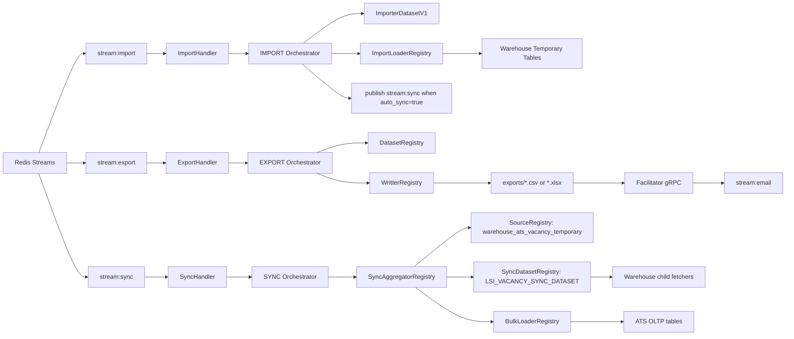
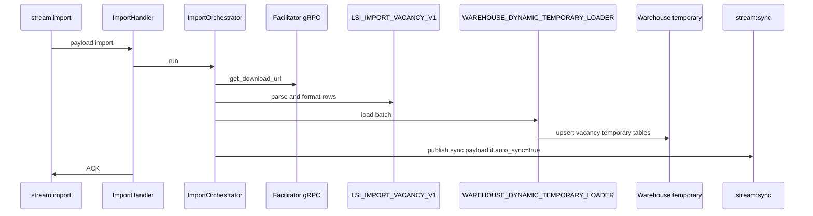
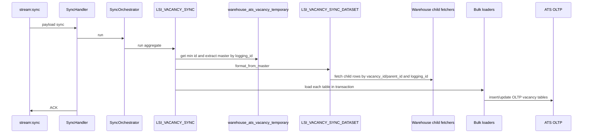

# Worker Exporter Architecture

Dokumen ini menjelaskan struktur `worker-exporter` berdasarkan kondisi kode saat ini. Fokus utama project ini adalah worker asynchronous untuk `IMPORT`, `EXPORT`, dan `SYNC` menggunakan Redis Stream, beberapa database PostgreSQL, dan gRPC facilitator.

Last updated: 2026-07-08

## Ringkasan

`worker-exporter` memiliki tiga flow runtime yang aktif:

- `IMPORT`: membaca payload dari `stream:import`, mengambil file import dari facilitator gRPC, parsing Excel, mapping dataset import, lalu insert/upsert ke tabel temporary warehouse.
- `EXPORT`: membaca payload dari `stream:export`, mengambil data dari dataset export, menulis file CSV/XLSX, upload ke facilitator gRPC, lalu publish email event.
- `SYNC`: membaca payload dari `stream:sync`, mengambil data temporary warehouse berdasarkan `logging_id`, merajut master dan child dataset, lalu bulk insert/upsert ke tabel OLTP ATS.

Flow `INGESTION` masih ada struktur dan stream group-nya, tetapi worker saat ini tidak men-spawn `IngestionHandler`, jadi belum aktif end-to-end.

## Runtime Topology



## Folder Structure

```text
src/
  bin/
    worker.rs                 # worker Redis Stream
    http.rs                   # HTTP API
  application/
    handler/                  # Redis message handlers
    orchestrator/             # IMPORT, EXPORT, SYNC coordinator
    runner/                   # ExportRunner, LoaderRunner, SyncRunner
    dataset.rs                # export/import/sync dataset registries
    fetch_source_regitry.rs   # DataFetcherJson registry
    ingestion/source_registry.rs
    import/import_registry.rs
    bulk_loader_registry.rs
    sync_aggregator_registry.rs
    writter.rs
  core/
    traits/                   # shared contracts
    types.rs                  # shared payload/result types
  domain/
    logging/                  # logging entity and repo contract
  infrastructure/
    datasets/
      export/
      import/
      sync/
    ingestion/                # OLTP/master/HRIS/organization fetch sources
    source/warehouse/temporary
    loader/
      warehouse/              # warehouse temporary loaders and logging repo
      oltp/ats/bulk_sync      # ATS OLTP sync bulk loaders
    redis.rs
migrations/
```

## Bootstrap

`src/boostrap.rs` membangun semua dependency utama:

- database pool dan client: warehouse, ATS, master, HRIS, organization
- Redis connection manager
- `RedisPublisher`
- `GrpcService`
- registries: orchestrator, dataset, importer dataset, sync dataset, fetcher, source, loader, bulk loader, writer, sync aggregator
- `LoggingWarehouse`
- HTTP usecases

`src/bin/worker.rs` membuat stream group:

- `stream:ingestion` dengan group `ingestion-group`
- `stream:export` dengan group `export-group`
- `stream:import` dengan group `import-group`
- `stream:sync` dengan group `sync-group`

Worker yang di-spawn per instance loop:

- 3 `ExportHandler`
- 3 `ImportHandler`
- 3 `SyncHandler`

## Redis Payload Contract

Consumer hanya membaca field Redis bernama `payload`.

Benar:

```bash
redis-cli -u "$REDIS_URL" XADD stream:sync '*' payload '{"tenant_id":"..."}'
```

Salah:

```bash
redis-cli -u "$REDIS_URL" XADD stream:sync '*' data '{"tenant_id":"..."}'
```

Struktur JSON utama mengikuti `OrchestratorJob`:

```json
{
  "tenant_id": "uuid-or-string",
  "email": "user@example.com",
  "actor_id": "actor-id",
  "orchestrator_name": "IMPORT | EXPORT | SYNC",
  "export_config": null,
  "ingestion_config": null,
  "import_config": null,
  "sync_config": null,
  "filters": []
}
```

Catatan penting:

- Handler memilih orchestrator dari stream, bukan dari `orchestrator_name`.
- `stream:import` selalu memanggil key registry `IMPORT`.
- `stream:export` selalu memanggil key registry `EXPORT`.
- `stream:sync` selalu memanggil key registry `SYNC`.
- `orchestrator_name` tetap dikirim untuk audit/debug payload.
- Jika payload invalid, handler tetap melakukan `ACK` setelah mencatat error.

### Payload Field Reference

Root `OrchestratorJob`:

| Field | Tipe | Dipakai oleh | Fungsi |
| --- | --- | --- | --- |
| `tenant_id` | string | semua flow | Tenant pemilik job. |
| `email` | string | export/import/sync logging | Email actor/requester. |
| `actor_id` | string | export/import/sync logging | User atau actor yang menjalankan job. |
| `orchestrator_name` | string | audit/debug | Nama flow di payload. Routing tetap berdasarkan stream handler. |
| `export_config` | object/null | `stream:export` | Config export dataset dan format file. |
| `import_config` | object/null | `stream:import` | Config import file, dataset, loader, field mapping. |
| `sync_config` | object/null | `stream:sync` dan auto-sync import | Config sync aggregate, logging id, dan chunk. |
| `ingestion_config` | object/null | ingestion lama | Saat ini belum aktif di worker runtime. |
| `filters` | array/null | export/source | Filter query berbasis `WhereField`. |

`export_config`:

| Field | Fungsi |
| --- | --- |
| `dataset` | Key di `DatasetRegistry`, contoh `lsi_ats_candidate_dataset`. |
| `format` | Key di `WritterRegistry`, contoh `csv` atau `excel`. |
| `fields` | Kolom output export, berisi `name` dan `column`. |
| `template_code` | Template email/export yang dikirim ke facilitator. |
| `structure_template_code` | Template struktur email/export. |
| `redirected_url` | URL redirect download, biasanya memakai placeholder `{{url}}`. |
| `chunk` | Ukuran batch fetch dataset. |

`import_config`:

| Field | Fungsi |
| --- | --- |
| `dataset` | Key di `ImporterDatasetV1`, contoh `LSI_IMPORT_VACANCY_V1`. |
| `loader` | Key di `ImportLoaderRegistry`, contoh `WAREHOUSE_DYNAMIC_TEMPORARY_LOADER`. |
| `key` | Object key file import di storage/facilitator. |
| `tenant_id` dan `group_id` | Nilai tenant/group yang ikut dimapping ke dataset import. |
| `auto_sync` | Jika `true`, import publish payload baru ke `stream:sync`. |
| `pipeline` | Key pipeline import, contoh `vacancy_import_pipeline`. |
| `master_table` | Nama table utama di result import, contoh `vacancy`. |
| `primary_column` | Kolom primary master table, contoh `id`. |
| `chunk` | Ukuran batch row Excel. |
| `fields` | Mapping header Excel ke kolom table result. |
| `sequential_table` | Daftar child table yang punya FK ke master. |
| `main_filterable` | Mapping value custom ke `filterable_attribute`. |
| `main_searchable` | Daftar field yang masuk keywords/searchable. |
| `fetcher_caching` | Daftar fetcher yang di-prefetch/cache sebelum import. |

`import_config.fields[]`:

| Field | Fungsi |
| --- | --- |
| `header` | Nama header Excel yang dibaca. |
| `column` | Target column. Bisa format `table.column` atau multi target dengan `|`, contoh `vacancy.job_position_id|vacancy.job_position_meta`. |
| `fetcher` | Key fetcher reference. Jika `null`, value dipakai langsung. |
| `type_data` | Tipe parsing import: `TEXT`, `UUID`, `DATE`, `NUMBER`, atau `Boolean`. |
| `is_custom` | Jika `true`, field masuk custom field, bukan kolom utama. |

`sync_config`:

| Field | Fungsi |
| --- | --- |
| `sync_aggregate` | Key di `SyncAggregatorRegistry`, contoh `LSI_VACANCY_SYNC`. |
| `logging_id` | Logging/import id yang dipakai filter data temporary. Wajib untuk sync vacancy. |
| `chunk` | Ukuran batch master rows yang diproses sync runner. |

## Payload Import

Import menggunakan `import_config`. Untuk vacancy LSI, dataset yang dipakai adalah `LSI_IMPORT_VACANCY_V1`.

Contoh payload import vacancy:

```json
{
  "tenant_id": "019e95a5-f5f3-7dd8-952b-0ce16845d9bd",
  "email": "verrandyb@gmail.com",
  "actor_id": "vearara",
  "orchestrator_name": "IMPORT",
  "export_config": null,
  "ingestion_config": null,
  "sync_config": {
    "sync_aggregate": "LSI_VACANCY_SYNC",
    "logging_id": null,
    "chunk": 100
  },
  "import_config": {
    "tenant_id": "019e95a5-f5f3-7dd8-952b-0ce16845d9bd",
    "group_id": "019e95a5-f5f3-7dd8-952b-0ce16845d9bd",
    "dataset": "LSI_IMPORT_VACANCY_V1",
    "auto_sync": true,
    "key": "v6/HRMS/import/template_excel_vacancy.xlsx",
    "data_source_type": "stream",
    "pipeline": "vacancy_import_pipeline",
    "loader": "WAREHOUSE_DYNAMIC_TEMPORARY_LOADER",
    "master_table": "vacancy",
    "primary_column": "id",
    "chunk": 500,
    "main_filterable": [
      {
        "main_column": "filterable_attribute",
        "import_column": "noRR"
      }
    ],
    "main_searchable": ["noRR"],
    "sequential_table": [
      {
        "table": "vacancy_pics",
        "is_custom": false,
        "fk_column": "vacancy_id"
      },
      {
        "table": "vacancy_stage",
        "is_custom": false,
        "fk_column": "vacancy_id"
      },
      {
        "table": "vacancy_requirement",
        "is_custom": false,
        "fk_column": "vacancy_id"
      }
    ],
    "fetcher_caching": [
      "JOB_POSITION",
      "ORGANIZATION",
      "EMPLOYEE",
      "MASTER_GEO"
    ],
    "fields": [
      {
        "header": "noRR",
        "column": "vacancy.noRR",
        "fetcher": null,
        "type_data": "TEXT",
        "is_custom": true
      },
      {
        "header": "position_name",
        "column": "vacancy.job_position_id|vacancy.job_position_meta",
        "fetcher": "JOB_POSITION",
        "type_data": "UUID",
        "is_custom": false
      },
      {
        "header": "pic",
        "column": "vacancy_pics.employee_id|vacancy_pics.employee_meta",
        "fetcher": "EMPLOYEE",
        "type_data": "UUID",
        "is_custom": false
      }
    ]
  },
  "filters": []
}
```

Import vacancy menulis ke warehouse temporary:

- `warehouse.ats_vacancy_temporary`
- `warehouse.ats_vacancy_custom_field`
- `warehouse.ats_vacancy_pic`
- `warehouse.ats_vacancy_stage`
- `warehouse.ats_vacancy_requirement`

Semua table temporary vacancy membawa `logging_id`. Pada `auto_sync=true`, `ImportOrchestrator` membuat payload baru ke `stream:sync` dan mengisi `sync_config.logging_id` dengan logging id import yang baru dibuat.

## Payload Sync

Sync menggunakan `sync_config`. Sync vacancy yang aktif memakai aggregate `LSI_VACANCY_SYNC`.

Contoh payload sync manual:

```json
{
  "tenant_id": "019e95a5-f5f3-7dd8-952b-0ce16845d9bd",
  "email": "verrandyb@gmail.com",
  "actor_id": "vearara",
  "orchestrator_name": "SYNC",
  "export_config": null,
  "ingestion_config": null,
  "import_config": null,
  "sync_config": {
    "sync_aggregate": "LSI_VACANCY_SYNC",
    "logging_id": "019f3d19-8948-71f3-92ac-067ebb6a05e8",
    "chunk": 100
  },
  "filters": []
}
```

Publish manual:

```bash
redis-cli -u "$REDIS_URL" XADD stream:sync '*' payload "$(cat sync-job.json)"
```

Flow sync vacancy:

1. `SyncHandler` membaca `stream:sync`.
2. `SyncOrchestrator` validasi `sync_config`.
3. Status logging diubah ke `SYNC_PROGRESS`.
4. `SyncAggregatorRegistry` resolve `LSI_VACANCY_SYNC`.
5. `AtsVacancyAtsSyncAggregator` mengambil source `warehouse_ats_vacancy_temporary`.
6. Source difilter `logging_id`.
7. `SyncRunner` mengambil master rows per `chunk`.
8. `LSI_VACANCY_SYNC_DATASET` merajut master vacancy dengan child table berdasarkan `vacancy_id` atau `parent_id` dan `logging_id`.
9. `BulkLoaderRegistry` menjalankan loader OLTP secara transaksi.
10. Status logging diubah ke `SYNC_SUCCESS` atau `SYNC_FAILED`.

Target OLTP sync vacancy:

- `vacancy.vacancy`
- `vacancy.vacancy_custom_field`
- `vacancy.vacancy_pic`
- `vacancy.vacancy_stage`
- `vacancy.vacancy_requirement`

Catatan `logging_id` sync:

- `logging_id` selalu masuk ke result dataset dan ikut dibaca bulk loader.
- Dataset scan semua row untuk resolve columns, lalu memastikan `logging_id` ada di columns.
- Fetcher child temporary difilter dengan `logging_id` agar batch import tidak bercampur.
- `WAREHOUSE_ATS_VACANCY_CUSTOM_FIELD.logging_id` bertipe UUID, sehingga filter casting-nya `uuid`.
- Child temporary lain memakai `varchar`, sehingga filter casting-nya `varchar`.

## Payload Export

Export menggunakan `export_config`.

Contoh payload export:

```json
{
  "tenant_id": "019e95a5-f5f3-7dd8-952b-0ce16845d9bd",
  "email": "user@example.com",
  "actor_id": "actor-1",
  "orchestrator_name": "EXPORT",
  "export_config": {
    "dataset": "lsi_ats_candidate_dataset",
    "format": "excel",
    "template_code": "LSI_EMAIL_EXPORT",
    "structure_template_code": "LSI_EXPORT_STRUCTURE",
    "redirected_url": "https://example.com/download?url={{url}}",
    "chunk": 1000,
    "fields": [
      {
        "name": "Candidate ID",
        "column": "candidate_id"
      },
      {
        "name": "Name",
        "column": "name"
      },
      {
        "name": "Email",
        "column": "email_address"
      }
    ]
  },
  "ingestion_config": null,
  "import_config": null,
  "sync_config": null,
  "filters": [
    {
      "field": "tenant_id",
      "operator": "=",
      "value": null,
      "values": ["019e95a5-f5f3-7dd8-952b-0ce16845d9bd"],
      "casting": "Uuid"
    }
  ]
}
```

Publish manual:

```bash
redis-cli -u "$REDIS_URL" XADD stream:export '*' payload "$(cat export-job.json)"
```

Output export:

1. Worker membuat file lokal di `exports/`.
2. File di-upload ke facilitator gRPC.
3. `download_url` disimpan di table `loggings`.
4. Event email dipublish ke `stream:email`.

## Registry Inventory

### Orchestrator Registry

| Key | Struct | Fungsi |
| --- | --- | --- |
| `IMPORT` | `ImportOrchestrator` | Import Excel/file ke temporary warehouse. Bisa publish auto sync ke `stream:sync`. |
| `EXPORT` | `ExportOrchestrator` | Export dataset ke CSV/XLSX, upload file, publish email event. |
| `SYNC` | `SyncOrchestrator` | Jalankan sync aggregator berdasarkan `sync_config.sync_aggregate`. |

### Writer Registry

| Key | Struct | Fungsi |
| --- | --- | --- |
| `csv` | `CsvExporter` | Menulis file CSV. |
| `excel` | `ExcelExporter` | Menulis file XLSX. |

### Export Dataset Registry

| Key | Struct | Fungsi |
| --- | --- | --- |
| `lsi_ats_candidate_dataset` | `LsiCandidateDataset` | Dataset export kandidat ATS. Menggunakan ATS DB, fetcher registry, source registry, dan gRPC service. |

### Importer Dataset Registry

Legacy `ImporterDataset`:

| Key | Struct | Fungsi |
| --- | --- | --- |
| `dynamic_dataset` | `DynamicDataset` | Dataset import dynamic versi lama. |
| `ats_import_lsi_vacancy_dataset` | `AtsImportLsiVacancyDataset` | Dataset import vacancy versi lama. |

`ImporterDatasetV1` yang dipakai import modern:

| Key | Struct | Fungsi |
| --- | --- | --- |
| `DYNAMIC_DATASET_V1` | `DynamicDatasetV1` | Mapping import generic berdasarkan config fields/sequential/custom fields. |
| `LSI_IMPORT_VACANCY_V1` | `LsiImportVacancyV1` | Mapping import vacancy LSI ke vacancy temporary, custom field, PIC, stage, requirement. |

### Sync Dataset Registry

| Key | Struct | Fungsi |
| --- | --- | --- |
| `LSI_VACANCY_SYNC_DATASET` | `LsiVacancySyncDataset` | Merajut master vacancy temporary dengan child temporary tables untuk bulk load ke OLTP ATS. |

### Sync Aggregator Registry

| Key | Struct | Fungsi |
| --- | --- | --- |
| `LSI_VACANCY_SYNC` | `AtsVacancyAtsSyncAggregator` | Sync vacancy dari warehouse temporary ke ATS OLTP. Mengikat source, sync dataset, bulk loaders, ATS client, dan logging repo. |

### Source Registry

`SourceRegistry` berisi source incremental atau source cursor-based. Biasanya dipakai export, ingestion lama, dan sync master source.

| Key | Struct | DB | Fungsi |
| --- | --- | --- | --- |
| `oltp_tenants` | `TenantSource` | organization | Source tenant organization. |
| `oltp_ats_candidate` | `AtsCandidateSource` | ats | Source candidate ATS. |
| `oltp_ats_vacancy` | `AtsVacancySource` | ats | Source vacancy ATS. |
| `oltp_ats_candidate_client_field` | `AtsCandidateClientFieldSource` | ats | Source candidate custom/client field. |
| `oltp_ats_applicant_bucket` | `AtsApplicantBucketSource` | ats | Source applicant bucket. |
| `oltp_ats_experience_source` | `AtsExperinceSource` | ats | Source candidate experience. |
| `oltp_ats_education_source` | `AtsEducationSource` | ats | Source candidate education. |
| `warehouse_ats_vacancy_temporary` | `AtsVacancyTemporarySource` | warehouse | Master source sync vacancy temporary. |
| `warehouse_ats_vacancy_custom_field_temporary` | `AtsVacancyCustomFieldTemporarySource` | warehouse | Source custom field vacancy temporary. |
| `warehouse_ats_vacancy_pic_temporary` | `AtsVacancyPicTemporarySource` | warehouse | Source PIC vacancy temporary. |
| `warehouse_ats_vacancy_stage_temporary` | `AtsVacancyStageTemporarySource` | warehouse | Source stage vacancy temporary. |
| `warehouse_ats_vacancy_requirement_temporary` | `AtsVacancyRequirementTemporarySource` | warehouse | Source requirement vacancy temporary. |

### Data Fetcher JSON Registry

`DataFetcherJsonRegistry` dipakai untuk lookup reference data pada import/export, dan untuk mengambil child warehouse table pada sync dataset.

| Key | Struct | DB | Fungsi |
| --- | --- | --- | --- |
| `ats_candidate_custom_field_fetcher` | `AtsCandidateClientFieldSource` | ats | Fetch candidate custom/client fields. |
| `ats_candidate_fetcher` | `AtsCandidateSource` | ats | Fetch candidate ATS. |
| `ats_candidate_field_fetcher` | `AtsCandidateClientFieldSource` | ats | Alias fetch candidate field. |
| `ats_education_fetcher` | `AtsEducationSource` | ats | Fetch education ATS. |
| `ats_experience_fetcher` | `AtsExperinceSource` | ats | Fetch experience ATS. |
| `ats_vacancy_fetcher` | `AtsVacancySource` | ats | Fetch vacancy ATS. |
| `MASTER_GEO` | `MasterGeoSource` | master | Lookup province/city/geo. |
| `MASTER_ITEMS` | `MasterMasterItemsSource` | master | Lookup master items. |
| `WAREHOUSE_ATS_VACANCY_TEMPORARY` | `AtsVacancyTemporarySource` | warehouse | Fetch vacancy temporary. |
| `WAREHOUSE_ATS_VACANCY_CUSTOM_FIELD` | `AtsVacancyCustomFieldTemporarySource` | warehouse | Fetch vacancy custom field temporary. |
| `WAREHOUSE_ATS_VACANCY_PIC` | `AtsVacancyPicTemporarySource` | warehouse | Fetch vacancy PIC temporary. |
| `WAREHOUSE_ATS_VACANCY_STAGE` | `AtsVacancyStageTemporarySource` | warehouse | Fetch vacancy stage temporary. |
| `WAREHOUSE_ATS_VACANCY_REQUIREMENT` | `AtsVacancyRequirementTemporarySource` | warehouse | Fetch vacancy requirement temporary. |
| `STAGE_TEMPLATE` | `IngestionRequirementStageTemplateSource` | ats | Lookup stage template. |
| `REQUIREMENT_STAGE_TEMPLATE` | `IngestionRequirementStageTemplateSource` | ats | Alias stage template. |
| `STAGE_TEMPLATE_DETAIL` | `IngestionRequirementStageTemplateDetailSource` | ats | Lookup stage template detail. |
| `REQUIREMENT_STAGE_TEMPLATE_DETAIL` | `IngestionRequirementStageTemplateDetailSource` | ats | Alias stage template detail. |
| `FORM_TEMPLATE` | `IngestionFormTemplateSource` | ats | Lookup form template. |
| `REQUIREMENT_TEMPLATE` | `IngestionFormTemplateSource` | ats | Alias requirement template. |
| `FORM_FIELD` | `IngestionFormFieldSource` | ats | Lookup form fields. |
| `FORM_TEMPLATE_DETAIL` | `IngestionFormTemplateDetailSource` | ats | Lookup form template detail. |
| `ATTEDANCE_LOCATION` | `IngestionHrisAttedanceLocationsSource` | hris | Lookup attendance location. |
| `EMPLOYEE` | `IngestionEmployeeSource` | hris | Lookup employee. |
| `EMPLOYMENT_STATUS` | `IngestionEmployeeStatusesSource` | hris | Lookup employment status. |
| `JOB_POSITION` | `IngestionOrganizationJobPositionSource` | organization | Lookup job position. |
| `ORGANIZATION` | `IngestionOrganizationUnitSource` | organization | Lookup organization unit. |
| `JOB_GRADE` | `IngestionJobGradeSource` | organization | Lookup job grade. |
| `JOB_LEVEL` | `IngestionJobLevelSource` | organization | Lookup job level. |

### Import Loader Registry

| Key | Struct | Target |
| --- | --- | --- |
| `WAREHOUSE_ATS_VACANCY_TEMPORARY` | `WarehouseAtsVacancyTemporaryLoader` | Warehouse ATS vacancy temporary. |
| `WAREHOUSE_DYNAMIC_TEMPORARY_LOADER` | `WarehouseDynamicTemporaryLoader` | Generic warehouse temporary loader. |

### Bulk Loader Registry

Bulk loaders dipakai oleh sync runner untuk insert/upsert ke ATS OLTP dalam satu transaksi.

| Key | Struct | Target table | Catatan |
| --- | --- | --- | --- |
| `ATS_VACANCY` | `AtsVacancyBulkLoader` | `vacancy.vacancy` | Cast `status` enum, map `current_hired` ke `currentHired`, conflict `id`. |
| `ATS_VACANCY_CUSTOM_FIELD` | `AtsVacancyCustomFieldBulkLoader` | `vacancy.vacancy_custom_field` | Cast `field_type` enum, conflict `id`. |
| `ATS_VACANCY_PIC` | `AtsVacancyPicBulkLoader` | `vacancy.vacancy_pic` | Tidak insert `id`; conflict `vacancy_id, employee_id`. |
| `ATS_VACANCY_STAGE` | `AtsVacancyStageBulkLoader` | `vacancy.vacancy_stage` | Cast `stage_email_template_reject` UUID, conflict `id`. |
| `ATS_VACANCY_REQUIREMENT` | `AtsVacancyRequirementBulkLoader` | `vacancy.vacancy_requirement` | Cast `field_type`, `field_purpose`, `compare_operator` enum, conflict `id`. |

### Incremental Loader Registry

| Key | Struct | Fungsi |
| --- | --- | --- |
| `tenants` | `TenantWarehouseSnapshot` | Loader snapshot tenant ke warehouse. |

### Pipeline Registry

| Registry | Key | Struct | Status |
| --- | --- | --- | --- |
| `PipelineImportRegistry` | `vacancy_import_pipeline` | `VacancyImportPipeline` | Terdaftar. |
| `PipelineRegistry` | none | none | Kosong, flow ingestion/export pipeline lama belum aktif. |

## Core Traits

| Trait | File | Fungsi |
| --- | --- | --- |
| `Orchestrator` | `core/traits/orchestrator.rs` | Kontrak `run(job, msg_id)` untuk IMPORT/EXPORT/SYNC. |
| `Dataset` | `core/traits/dataset_trait.rs` | Dataset export batch. |
| `ImporterDatasetV1` | `core/traits/dataset_trait.rs` | Mapping row import ke table result. |
| `SyncDataset` | `core/traits/dataset_trait.rs` | Mapping master rows sync menjadi `SycnTableResult`. |
| `DataFetcherJson` | `core/traits/etl.rs` | Fetch rows sebagai `serde_json::Value`. |
| `SourceIncrementalExtract` | `core/traits/extractor/source_incremental_extract.rs` | Source cursor/incremental. |
| `ImportLoadPersitence` | `core/traits/load.rs` | Loader import ke warehouse temporary. |
| `BulkLoaderTrait` | `core/traits/load.rs` | Bulk loader sync ke OLTP. |
| `SyncAggregator` | `core/traits/load.rs` | Agregator sync satu domain. |
| `WritterTrait` | `core/traits/writter/writter_trait.rs` | Writer CSV/XLSX export. |
| `Consumer` | `core/traits/consumer.rs` | Redis consumer contract. |
| `Publisher` | `core/traits/publisher.rs` | Redis publisher contract. |

## LSI Vacancy End-to-End

### Import to Warehouse



### Warehouse to ATS OLTP



## Logging Status

Logging disimpan lewat `LoggingWarehouse` ke table `loggings`.

Status umum:

- `PROCESSING`
- `COMPLETED`
- `FAILED`
- `SYNC_PROGRESS`
- `SYNC_SUCCESS`
- `SYNC_FAILED`

Field penting:

- `id`
- `stream_id`
- `logging_type`
- `status`
- `processed_count`
- `cursor`
- `download_url`
- `error`
- `tenant_id`
- `email`
- `actor_id`

## Environment Variables

Wajib untuk runtime normal:

- `WAREHOUSE_DATABASE_URL`
- `ORGANIZATION_DATABASE_URL`
- `MASTER_DATABASE_URL`
- `ATS_DATABASE_URL`
- `HRIS_DATABASE_URL`
- `REDIS_URL`
- `FACILITATOR_GRPC_URL`
- `ATS_GRPC_URL`

Opsional:

- `HOST`
- `PORT`

## Running Locally

HTTP:

```bash
cargo run --bin http
```

Worker:

```bash
cargo run --bin worker
```

Docker Compose:

```bash
docker compose up --build
```

## Cara Menambah Modul Baru

### Tambah Export Dataset

1. Implement `Dataset`.
2. Register di `build_dataset_registry`.
3. Pakai key tersebut di `export_config.dataset`.

### Tambah Import Dataset

1. Implement `ImporterDatasetV1`.
2. Register di `build_importer_dataset_registry_v1`.
3. Pakai key tersebut di `import_config.dataset`.

### Tambah Fetcher

1. Implement `DataFetcherJson`.
2. Register di `build_data_fetcher_json_registry`.
3. Pakai key fetcher pada `import_config.fields[].fetcher` atau dataset custom.

### Tambah Source Incremental

1. Implement `SourceIncrementalExtract`.
2. Register di `build_source_registry`.
3. Pakai key source dari runner/aggregator.

### Tambah Sync Domain

1. Implement `SyncDataset`.
2. Register di `build_sync_dataset_registry`.
3. Implement `SyncAggregator`.
4. Register di `build_sync_aggregator_registry`.
5. Buat `BulkLoaderTrait` untuk target tables.
6. Register loader di `build_bulk_loader_registry`.
7. Publish payload ke `stream:sync` dengan `sync_config.sync_aggregate`.

### Tambah Bulk Loader

1. Implement `BulkLoaderTrait`.
2. Jika generic table loader cukup, gunakan `OltpBulkTableLoader`.
3. Set `source_table`, `target_table`, `column_map`, `column_castings`, dan `conflict_columns`.
4. Register di `build_bulk_loader_registry`.

## Known Limitations

- Ada typo lama di beberapa nama file/type seperti `writter`, `regitry`, dan `SycnTableResult`; jangan tambah typo baru, tetapi hati-hati saat refactor karena sudah dipakai banyak tempat.
- `PipelineRegistry` generic masih kosong.
- `stream:ingestion` group dibuat, tetapi handler ingestion tidak di-spawn di worker saat ini.
- Banyak warning compile masih ada.
- Beberapa schema warehouse dan OLTP berbeda tipe, sehingga sync bulk loader perlu `column_castings`.
- `logging_id` custom field warehouse bertipe UUID, sedangkan beberapa child table lain bertipe varchar.
