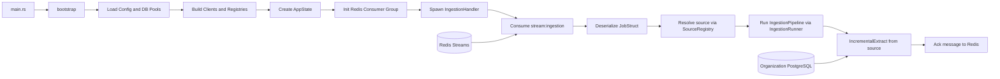

# Export Worker Skeleton - Architecture Breakdown

## Ringkasan

Repository ini adalah skeleton worker berbasis Rust untuk menjalankan proses ingestion dan export secara asynchronous. Arsitektur dipisahkan ke beberapa layer agar mudah di-extend:

- application: orchestration, handler, runner, pipeline, registry
- core: kontrak trait dan abstraksi umum
- domain: model/aturan domain per dataset
- infrastructure: adapter ke Redis, database, dan writer

Status saat ini: ingestion flow dasar sudah berjalan, sedangkan sebagian flow export masih berupa kerangka (WIP).

## Tujuan Arsitektur

1. Memisahkan business contract dari implementasi teknis.
2. Memudahkan penambahan source/dataset/format export baru.
3. Menjalankan worker event-driven melalui Redis Stream + Consumer Group.
4. Menjaga pipeline incremental dengan cursor (UUID) untuk batch processing.

## High-Level Runtime Flow



## Struktur Layer

### 1. Entrypoint dan Bootstrap

- src/main.rs
  - Menjalankan bootstrap di runtime tokio.
- src/boostrap.rs
  - Inisialisasi logger, config, DB manager, client, registry, dan worker consumer.
  - Membuat Redis consumer group:
    - stream:ingestion / ingestion-group
    - stream:export / export-group
  - Menjalankan IngestionHandler di task terpisah.

### 2. Application Layer

Folder utama: src/application

Komponen inti:

- handler
  - ingestion_handler.rs: loop consume -> parse payload -> pilih source -> jalankan ingestion runner -> ack.
  - handler_registry.rs: type alias registry untuk JobHandler.
- pipelines
  - ingestion_pipeline.rs: implementasi PipelineTrait, memanggil IncrementalExtract.
  - export_pipeline.rs: kerangka pipeline export (mirip ingestion, masih generik).
  - pipeline_registry.rs: registry untuk PipelineTrait.
- runner
  - ingestion_runner.rs: batching loop berbasis cursor UUID.
  - export_runner.rs: masih skeleton.
- source
  - source_registry.rs: registry sumber IncrementalExtract.
- exporter
  - kontrak factory/registry untuk flow export, banyak bagian masih placeholder.
- orchestrator
  - export_orchestrator.rs: rancangan koordinasi ingestion + export, belum fully wired.

### 3. Core Layer (Abstraction Contracts)

Folder utama: src/core

Trait penting:

- consumer::Consumer
  - interface consume dan ack pesan.
- handler::JobHandler
  - kontrak handler worker.
- extractor::IncrementalExtract
  - kontrak extract(cursor, limit, params) -> rows + next_cursor.
- pipeline::PipelineTrait
  - kontrak run(cursor, limit) untuk pipeline incremental.
- exporter::ExportWriter
  - kontrak writer format export (headers, rows, finish).
- tenants / templates / transformer
  - extension points untuk enrichment tenant, render template, transform data.

Core juga menyimpan:

- config::Config
  - membaca env variable URL database.
- config::DatabaseManager
  - membuat pool koneksi PostgreSQL untuk warehouse dan organization.

### 4. Domain Layer

Folder utama: src/domain

Implementasi yang terlihat:

- datasets/candidate_pool/dataset.rs
  - transform model snapshot menjadi ExportRow.
  - menjadi contoh pola mapping domain -> output export.

Sebagian modul domain lain masih kosong sebagai placeholder perluasan berikutnya.

### 5. Infrastructure Layer

Folder utama: src/infrastructure

Adapter aktif:

- redis.rs
  - implementasi Consumer untuk Redis Stream menggunakan xreadgroup + xack.
- ingestion/organization/sql/tenant/source.rs
  - implementasi IncrementalExtract untuk tabel tenant di Organization PostgreSQL.
  - query incremental berbasis id UUID cursor.

Adapter yang masih skeleton atau belum lengkap:

- exporter/csv_exporter.rs (kosong)
- exporter/exce_exporter.rs (kosong)
- warehouse/snapshots/candidate_pool/query.rs (sebagian besar masih komentar)
- beberapa connector ingestion (mysql/hris/postgres) baru berupa wrapper client.

## Kontrak Data Antar Komponen

### Job Payload

JobStruct di core/traits/handler.rs:

- pipeline: nama pipeline
- tenant: optional tenant
- job_type: jenis job
- source: key source pada registry

### Message Transport

ConsumerMessage di core/traits/consumer.rs:

- id: Redis stream entry id
- payload: JSON string untuk deserialisasi JobStruct

### Incremental Processing

1. Runner memanggil pipeline.run(cursor, limit).
2. Pipeline memanggil source.extract(cursor, limit, params).
3. Source mengembalikan rows JSON + next_cursor.
4. Runner lanjut sampai next_cursor None.

## Konfigurasi Environment

Variabel yang dipakai kode saat ini:

- WAREHOUSE_DATABASE_URL
- ORGANIZATION_DATABASE_URL
- REDIS_URL (default: redis://127.0.0.1:6379 jika tidak di-set)

## Dependensi Eksternal

- PostgreSQL (sqlx)
- Redis Streams + Consumer Groups
- Tokio runtime
- Tracing untuk logging
- Trait-based abstraction melalui async-trait

## Status Implementasi Saat Ini

### Sudah Berfungsi (Core Ingestion Path)

1. Bootstrap service dan inisialisasi koneksi.
2. Setup Redis stream groups.
3. Consume message dari stream:ingestion.
4. Resolve source dari SourceRegistry.
5. Jalankan ingestion incremental pipeline.
6. Ack message setelah sukses.

### Masih WIP / Skeleton

1. Export writer konkret (CSV/XLSX) belum diimplementasikan.
2. Export orchestrator belum digunakan penuh dalam bootstrap.
3. Factory untuk dataset/tenant/export pipeline belum jadi.
4. Beberapa modul dideklarasikan tapi file implementasinya belum ada/masih kosong.

## Known Gaps yang Perlu Dibereskan

Berikut gap yang terlihat dari struktur dan kompilasi saat ini:

1. src/core/mod.rs mendeklarasikan mod orchestrator, namun file belum tersedia.
2. src/infrastructure/exporter/mod.rs mengacu ke excel_exporter, tetapi file bernama exce_exporter.rs.
3. src/boostrap.rs masih memiliki baris register exporter yang belum selesai.
4. Banyak warning unused import/variable karena modul masih tahap skeleton.

## Cara Menambah Komponen Baru

### Tambah Source Ingestion Baru

1. Implement trait IncrementalExtract pada source baru di infrastructure/ingestion.
2. Register source di SourceRegistry saat bootstrap.
3. Kirim job dengan source key yang sama di payload Redis.

### Tambah Pipeline Baru

1. Implement PipelineTrait di application/pipelines.
2. Tambah wiring di registry/orchestrator.
3. Buat handler/orchestrator untuk jalur job yang relevan.

### Tambah Format Export Baru

1. Implement ExportWriter baru (misal CSV/XLSX/Parquet).
2. Register writer ke ExportRegistry.
3. Sambungkan ke ExportFactory + ExportPipeline yang sesuai.

## Quick Start (Current Skeleton)

1. Siapkan env variable database dan Redis.
2. Jalankan Redis server dan pastikan stream dapat dibuat.
3. Jalankan worker:

```bash
cargo run
```

4. Push payload job JSON ke stream:ingestion sesuai format JobStruct.

## Catatan

Dokumentasi ini merefleksikan kondisi kode saat ini (skeleton + partial implementation). Jika struktur berubah, update bagian:

- High-Level Runtime Flow
- Status Implementasi
- Known Gaps
