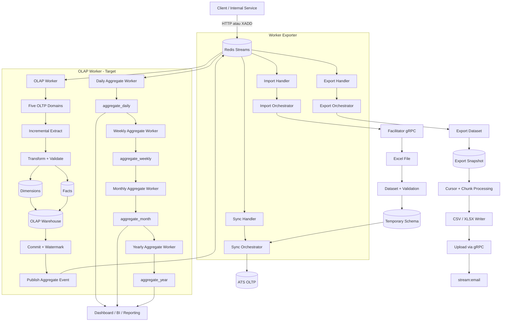

# Worker Exporter

## Multi-Domain, Multi-Tenant Data Worker

**Worker Exporter** adalah platform worker berbasis Rust dan Tokio untuk memproses import,
export, sinkronisasi data, serta rancangan OLAP secara asynchronous.

Project ini dibangun sebagai **modular monolith dengan multi-process deployment**: satu
codebase, satu kumpulan domain dan infrastructure, tetapi workload dapat dijalankan melalui
executable yang berbeda.

> Catatan status: IMPORT, EXPORT, SYNC, Redis Streams, HTTP API, registry, dan chunk processing
> sudah ada di project. `worker_olap`, export snapshot projector, serta pipeline aggregate
> daily/weekly/monthly/yearly adalah target pengembangan arsitektur berikutnya.

## Latar belakang masalah

Worker perlu melayani:

- lima domain OLTP yang berbeda;
- banyak tenant dengan kebutuhan custom masing-masing;
- import file Excel dalam jumlah besar;
- export data kandidat dan vacancy dalam jumlah besar;
- sinkronisasi data temporary ke sistem ATS;
- kebutuhan analitik tanpa membebani database transaksi.

Contoh masalah export: sistem dapat memiliki sekitar 3 juta kandidat, tetapi satu candidate
pool hanya membutuhkan sekitar 100 ribu kandidat. Export tidak seharusnya melakukan scan dan
join ulang seluruh data OLTP setiap kali user meminta file.

## Solusi arsitektur

Data diproses secara asynchronous melalui Redis Streams. Setiap workload memiliki tanggung
jawab yang jelas:

| Executable | Tanggung jawab |
| --- | --- |
| `http` | HTTP API, health check, dan publish job ke Redis. |
| `worker` | IMPORT, EXPORT, dan SYNC. |
| `worker_olap` | Extract OLTP, membangun snapshot/dimension/fact, dan aggregate analytics. |

Ketiganya tetap menggunakan codebase dan contract yang sama. Pemisahan process dilakukan agar
export berat atau proses OLAP tidak menghambat HTTP dan pekerjaan operasional lainnya.

## Gambaran arsitektur



## Struktur folder arsitektur

```text
worker-exporter/
├── src/
│   ├── bin/
│   │   ├── http.rs              # HTTP API
│   │   ├── worker.rs            # IMPORT, EXPORT, dan SYNC worker
│   │   └── worker_olap.rs       # Target OLAP worker (rancangan)
│   ├── application/
│   │   ├── handler/             # Consumer handler
│   │   ├── orchestrator/        # Flow IMPORT, EXPORT, dan SYNC
│   │   ├── runner/              # Batch, cursor, dan proses job
│   │   ├── datasets/             # Dataset import/export/sync
│   │   └── *registry.rs         # Registry implementasi
│   ├── core/
│   │   ├── traits/              # Contract dan port
│   │   └── types.rs             # Shared payload dan data types
│   ├── domain/
│   │   ├── logging/             # Entity dan contract logging
│   │   ├── oltp/                # Model domain OLTP
│   │   └── snapshots/           # Model read/snapshot
│   ├── infrastructure/
│   │   ├── db/                  # Database client dan pool
│   │   ├── source/              # Source reader OLTP/warehouse
│   │   ├── loader/              # Loader warehouse dan OLTP
│   │   ├── exporter/            # CSV dan XLSX writer
│   │   ├── ingestion/           # Fetcher lintas domain
│   │   ├── pipeline/            # Pipeline teknis
│   │   ├── proto/               # Definisi gRPC
│   │   └── redis.rs             # Redis Streams adapter
│   └── utils/                   # Helper query, cursor, JSON, dan value
├── migrations/                 # Migrasi schema warehouse
├── docs/                       # Dokumentasi arsitektur dan operasional
└── Cargo.toml
```

Struktur ini memisahkan business flow, contract, domain model, dan adapter infrastructure.
Detail folder tersedia di [directory-structure.md](directory-structure.md).

## Alur utama

### IMPORT

1. Job masuk melalui `stream:import`.
2. Import orchestrator mengambil object key Excel melalui facilitator.
3. `buffer` mode membaca file dari memory; `stream` mode menyimpan file sementara ke `/tmp`.
4. Baris Excel diproses per `chunk`.
5. Dataset melakukan mapping, lookup fetcher, validasi, dan pembentukan data master/child.
6. Loader menulis hasilnya ke temporary warehouse.
7. Jika `auto_sync` aktif, worker menerbitkan job baru ke `stream:sync`.

### EXPORT

1. Job masuk melalui `stream:export`.
2. Export orchestrator memilih dataset dan writer melalui registry.
3. Dataset export mengambil data secara incremental menggunakan cursor.
4. Data diproses per `chunk` dan ditulis bertahap ke CSV/XLSX.
5. Hasil file di-upload melalui facilitator.
6. Worker dapat menerbitkan event email ke `stream:email`.

Untuk skala besar, export idealnya membaca `export snapshot`, yaitu read model yang sudah
dipersiapkan dari data terbaru. Dengan demikian, export candidate management cukup membaca
candidate pool yang diperlukan, bukan mengulang join terhadap jutaan row OLTP.

## Hasil uji concurrency awal

Uji awal dilakukan secara bersamaan dengan resource terbatas:

| Skenario | Hasil |
| --- | --- |
| 3 worker IMPORT untuk data 1.000 row | Berhasil berjalan |
| 3 worker EXPORT untuk data 500 row | Berhasil berjalan |
| Total concurrency | 3 IMPORT + 3 EXPORT |
| Resource | 1 CPU core dan 256 MB memory |

Hasil ini menunjukkan bahwa pipeline chunk, Redis Streams, dan worker masih dapat berjalan
bersamaan pada resource kecil. Angka ini adalah hasil smoke test awal, bukan batas kapasitas
produksi. Benchmark lanjutan perlu mencatat durasi job, peak memory, throughput, query database,
dan panjang antrean Redis.

### SYNC

1. Job masuk melalui `stream:sync`.
2. Sync memakai `logging_id` dari proses import.
3. Aggregator mengambil data temporary berdasarkan logging tersebut.
4. Data diproses per batch dan di-upsert ke ATS OLTP.

### OLAP

1. Job atau event masuk melalui stream OLAP.
2. Worker mengambil perubahan dari lima domain OLTP menggunakan cursor/watermark.
3. Data ditransformasi dan divalidasi.
4. Data dimuat ke dimension dan fact table.
5. Setelah transaksi berhasil di-commit, worker menerbitkan event agregasi.
6. Worker agregasi memperbarui data daily, weekly, monthly, dan yearly secara asynchronous.

## Lima logical schema data

Kelima schema ini memiliki fungsi berbeda dan tidak harus menjadi database fisik yang berbeda.

| Schema | Tujuan |
| --- | --- |
| `temporary` | Staging data import/extract sebelum validasi dan transform selesai. |
| `snapshot` | Read model berisi kondisi terbaru untuk kebutuhan export cepat. |
| `dimensions` | Data master seperti tenant, candidate, vacancy, location, dan entity referensi. |
| `facts` | Data transaksi pada grain yang jelas, bersumber dari event/transaksi OLTP. |
| `aggregate` | Hasil analitik daily, weekly, monthly, dan yearly. |

`snapshot` bukan pengganti fact atau aggregate. Snapshot dibuat untuk kebutuhan baca cepat dan
spesifik export; aggregate dibuat untuk kebutuhan analitik.

Untuk snapshot “data terbaru”, `GROUP BY` saja tidak cukup. Proyeksi snapshot perlu menggunakan
upsert berdasarkan business key dan version/`updated_at`, atau pola seperti:

```sql
ROW_NUMBER() OVER (
    PARTITION BY tenant_id, vacancy_id, candidate_pool_id, candidate_id
    ORDER BY updated_at DESC
)
```

## Multi-tenant dan customization

Setiap data yang tenant-scoped membawa identitas tenant, minimal:

```text
tenant_id
source_id
job_id / logging_id
updated_at
```

Customization tenant tidak diletakkan sebagai percabangan besar di handler atau orchestrator.
Tenant dapat diarahkan ke implementasi melalui registry:

```text
Tenant
  ↓
Dataset Registry
  ↓
Pipeline Registry
  ↓
Warehouse Loader Registry
```

Contoh extension point:

- `Orchestrator Registry` memilih flow `IMPORT`, `EXPORT`, atau `SYNC`;
- `export_config.dataset` memilih dataset export;
- `export_config.format` memilih writer CSV/XLSX;
- `import_config.dataset` memilih mapper import;
- `import_config.pipeline` memilih pipeline;
- `import_config.loader` memilih loader warehouse;
- `sync_config.sync_aggregate` memilih aggregator sync.

Dengan pola ini, kebutuhan tenant baru cukup menambahkan implementasi dan mendaftarkan key-nya.
Handler, orchestrator, dan flow utama tetap digunakan bersama. Ini tetap membutuhkan code
change dan deployment, tetapi tidak membutuhkan perubahan pada seluruh sistem.

## Registry Pattern

Registry menyimpan implementasi berdasarkan key string dan mengembalikan trait object yang
sesuai. Orchestrator mengetahui contract, bukan detail setiap adapter.

```text
Registry<Key, Implementation>
```

Urutan registry dalam flow worker:

```text
Redis Stream
  ↓
Orchestrator Registry
  ↓
Dataset / Pipeline / Loader / Writer Registry
  ↓
Database, file, atau service eksternal
```

`Orchestrator Registry` menjadi entry point flow bisnis. Saat ini key utamanya adalah
`IMPORT`, `EXPORT`, dan `SYNC`. Registry di bawahnya menyediakan implementasi spesifik tanpa
membuat handler baru untuk setiap dataset atau tenant.

Manfaatnya:

- dataset baru tidak perlu membuat handler baru;
- format export baru tidak perlu mengubah export orchestrator;
- loader tenant-specific dapat ditambahkan tanpa mengubah alur import;
- source dan pipeline dapat ditukar melalui konfigurasi job.

Trade-off-nya adalah key string harus valid. Key yang salah baru terlihat saat runtime, sehingga
registry perlu divalidasi saat startup dan payload perlu memiliki validation yang jelas.

## Chunk dan stream processing

### Import

- `buffer`: lebih sederhana untuk file kecil, tetapi seluruh file berada di memory;
- `stream`: lebih cocok untuk file besar karena file diproses melalui temporary file;
- `chunk`: membatasi jumlah row yang dipetakan dan dimuat dalam satu batch.

### Export

- cursor menghindari offset besar pada database;
- chunk membatasi row yang diproses per iterasi;
- writer menulis row secara bertahap ke CSV/XLSX;
- snapshot menghindari join besar ketika user meminta export.

## Skalabilitas

Desain ini dapat scale secara horizontal karena Redis Consumer Group membagi job antar process.
Pemisahan `http`, `worker`, dan `worker_olap` juga memungkinkan setiap workload memiliki jumlah
replica dan resource yang berbeda.

Hal yang harus diperkuat sebelum production scale besar:

1. ACK hanya setelah job sukses, dengan retry terbatas dan dead-letter queue.
2. Pending Redis message recovery menggunakan mekanisme claim/reclaim.
3. Consumer name unik per instance.
4. Idempotency untuk import, snapshot, fact, dan aggregate.
5. Outbox atau mekanisme event setelah transaksi dimension/fact berhasil commit.
6. Index, partitioning, dan query plan berbasis `tenant_id` serta filter export utama.
7. Rate limit atau resource quota agar tenant besar tidak menjadi noisy neighbor.
8. Cleanup file export dan graceful shutdown worker.

## Penilaian arsitektur

Arsitektur ini paling tepat disebut **modular, event-driven monolith**. Ia belum menjadi
microservice penuh karena masih berbagi codebase, contract, dan infrastructure, tetapi dapat
dijalankan sebagai beberapa process/service yang di-scale secara independen.

Kompleksitasnya wajar untuk sistem yang memiliki lima domain OLTP, multi-tenant customization,
import/export, sinkronisasi, snapshot read model, dan OLAP. Fokus pengembangan sebaiknya bukan
menambah lebih banyak layer, melainkan menjaga batas tanggung jawab, reliability worker, dan
konsistensi data.

## Nilai project

Project ini menunjukkan kemampuan untuk:

- merancang arsitektur worker asynchronous berbasis Rust/Tokio;
- mengintegrasikan Redis Streams, PostgreSQL, gRPC, CSV, dan XLSX;
- membuat pipeline import/export yang berjalan dengan chunk dan cursor;
- merancang read model snapshot untuk export berskala besar;
- mendukung lima domain OLTP dan customization multi-tenant;
- menggunakan registry dan trait untuk extension point yang terkontrol;
- memisahkan workload operasional dan analitik tanpa menggandakan codebase.

## Ringkasan untuk LinkedIn

Saya membangun sebuah data worker berbasis Rust untuk menangani import, export, sinkronisasi,
dan kebutuhan OLAP pada sistem multi-tenant dengan lima domain OLTP.

Untuk menjaga performa, data import dan extract diproses secara asynchronous melalui Redis
Streams. Export menggunakan cursor, chunk processing, dan snapshot read model agar tidak perlu
melakukan scan serta join terhadap jutaan data setiap kali user meminta file.

Customization tenant dilakukan melalui registry dataset, pipeline, dan warehouse loader tanpa
mengubah handler atau orchestrator utama. Ke depan, worker OLAP akan membangun dimension dan fact
table, kemudian memperbarui aggregate daily, weekly, monthly, dan yearly melalui event terpisah.

Project ini dibangun sebagai modular monolith multi-process: satu codebase, tetapi workload HTTP,
operasional worker, dan OLAP dapat di-scale secara independen.

> Modularitas tidak selalu berarti memecah semuanya menjadi microservices. Kadang yang lebih
> penting adalah memisahkan tanggung jawab, alur data, dan beban kerja dengan jelas.

## Teknologi

`Rust` · `Tokio` · `Redis Streams` · `PostgreSQL` · `SQLx` · `Axum` · `gRPC/Tonic` · `CSV` ·
`XLSX` · `Docker`
