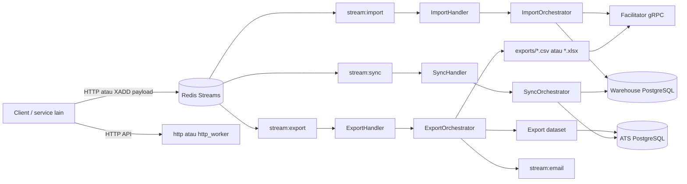

# Arsitektur

## Gambaran umum

Worker menerima pekerjaan dari Redis Streams, memilih orchestrator berdasarkan stream yang dikonsumsi, lalu menjalankan pipeline untuk import, export, atau sinkronisasi. Semua dependency dibuat sekali pada `bootstrap()` dan dibagikan lewat `Arc<AppState>`.

## Bootstrap dan dependency

`src/boostrap.rs` adalah composition root aplikasi. Urutan utamanya:

1. Membaca environment melalui `Config`.
2. Membuat `ConnectionManager` Redis dan `RedisPublisher`.
3. Membuka pool PostgreSQL untuk warehouse, organization, ATS, master, dan HRIS.
4. Membuat client database dan client gRPC facilitator/ATS.
5. Mendaftarkan source, dataset, fetcher, loader, writer, dan orchestrator.
6. Menyusun `AppState` yang dipakai handler HTTP dan consumer Redis.

`http_worker` kemudian membuat consumer group Redis dan menyalakan handler. `worker` melakukan hal serupa, tetapi tanpa HTTP API.

## Layer aplikasi

| Layer | Lokasi | Tanggung jawab |
| --- | --- | --- |
| Entrypoint | `src/bin/` | Menjalankan HTTP API, worker, atau keduanya. |
| Application | `src/application/` | Handler Redis, orchestrator, runner, registri, use case HTTP, dan koordinasi flow. |
| Core | `src/core/` | Kontrak trait, tipe payload, konfigurasi, dan registry generik. |
| Domain | `src/domain/` | Entitas serta kontrak domain, terutama logging. |
| Infrastructure | `src/infrastructure/` | Redis adapter, database client/source/loader, exporter file, dan gRPC proto. |
| Utilities | `src/utils/` | Resolver export, filter/fetcher/cache, JSON path, custom-field, query, dan cursor. |

Kode bergantung pada trait dari `core`; implementasi teknis ditempatkan di `infrastructure`. Sebagai contoh, `Dataset`, `WritterTrait`, `SourceIncrementalExtract`, `ImportLoadPersitence`, dan `BulkLoaderTrait` didefinisikan sebagai kontrak lalu diisi oleh adapter infrastruktur.

## Pola registry

`Registry<T>` di `src/core/traits/strategy/registry.rs` menyimpan implementasi berdasarkan key string. Pola ini adalah titik ekstensi utama. Key dalam payload harus persis sama dengan key yang didaftarkan saat bootstrap.

| Registry | Contoh key aktif | Dipakai oleh |
| --- | --- | --- |
| Orchestrator | `IMPORT`, `EXPORT`, `SYNC` | Handler berdasarkan stream. |
| Writer | `csv`, `excel` | `export_config.format`. |
| Export dataset | `lsi_ats_candidate_dataset`, `lsi_applicant_dataset` | `export_config.dataset`. |
| Import dataset v1 | `DYNAMIC_DATASET_V1`, `LSI_IMPORT_VACANCY_V1` | `import_config.dataset`. |
| Import loader | `WAREHOUSE_ATS_VACANCY_TEMPORARY`, `WAREHOUSE_DYNAMIC_TEMPORARY_LOADER` | `import_config.loader`. |
| Import pipeline | `vacancy_import_pipeline` | `import_config.pipeline`. |
| Sync aggregator | `LSI_VACANCY_SYNC` | `sync_config.sync_aggregate`. |

Source dan data fetcher juga memakai registry, tetapi sebagian besar dipanggil internal oleh dataset/aggregator. Lihat [struktur direktori](directory-structure.md) dan [pengembangan](operations-and-development.md#menambah-kemampuan-baru).

## Flow runtime

### IMPORT

1. `ImportHandler` mengambil `payload` dari `stream:import` dan memilih orchestrator `IMPORT`.
2. `ImportOrchestrator` membuat record logging berstatus `PROCESSING` di warehouse.
3. Object key pada `import_config.key` diterjemahkan menjadi URL unduhan melalui facilitator gRPC.
4. Buffer mode membaca Excel langsung dari memory. Stream mode mengunduh response bertahap ke `/tmp/worker-exporter-import-<uuid>.xlsx`, membuka workbook dari file tersebut, lalu menghapus file sementara setelah proses selesai.
5. Sheet pertama dibaca dan diproses per `chunk` mulai `start_row` (default baris 2). Fetcher reference diprefetch secara batch per chunk ke cache in-memory ber-TTL 30 menit dan kapasitas maksimum 5.000 entry.
6. Dataset import memetakan setiap baris ke master/child/custom-field lalu loader menulisnya ke tabel temporary warehouse. Lookup lanjutan menggunakan helper cache untuk normalisasi key, operator casting, cache hit/miss, dan logging.
7. Jika `auto_sync` bernilai `true`, payload SYNC baru dipublikasikan ke `stream:sync` dengan `logging_id` hasil import.

### EXPORT

1. `ExportHandler` memilih orchestrator `EXPORT`.
2. `ExportOrchestrator` menyimpan logging awal dan memilih writer serta dataset dari registry.
3. Filter `tenant_id` selalu diterapkan; `filters` dari payload ditambahkan sesudahnya.
4. `ExportRunner` membaca dataset secara cursor-based per `export_config.chunk`, meneruskan konfigurasi field serta cache bersama ke dataset, menulis header dan baris ke CSV/XLSX, lalu memperbarui progress logging.
5. Berkas sementara dibuat di `exports/<stream-id-yang-disanitasi>.<ext>`.
6. Berkas diunggah dengan facilitator gRPC. Key hasil upload dicatat sebagai `download_url` dan event email dikirim ke `stream:email`.

### Reusable dataset utilities

Dataset import dan export tidak lagi menyimpan seluruh helper lookup di masing-masing file.
Helper lintas dataset berada di `src/utils/`:

| Utility | Peran |
| --- | --- |
| `fetcher.rs` | Normalisasi token, operator filter, filter UUID, cache key, single fetch, batch fetch, dan logging cache. |
| `json_value.rs` | Resolusi JSON path, flatten array, konversi keyword, unique string values, dan index row. |
| `custom_field.rs` | Resolusi nilai EAV, grouping custom field per parent, dan index row custom field. |
| `export_resolver.rs` | Resolusi column path terhadap beberapa source JSON dan format nilai export. |

`ApplicantDataset`, `LsiCandidateDataset`, `DynamicDatasetV1`, dan `LsiImportVacancyV1`
menggunakan helper tersebut. Aturan bisnis seperti source utama applicant, hubungan vacancy,
job grade, dan work location tetap berada di dataset masing-masing. `SyncVacancyDataset` yang
ditinjau hanya berisi struct kosong, sehingga tidak dipaksa memakai helper yang tidak relevan.

### SYNC

1. `SyncHandler` memilih orchestrator `SYNC`.
2. `SyncOrchestrator` mewajibkan `sync_config` dan `logging_id`, lalu mengubah status logging menjadi `SYNC_PROGRESS`.
3. Aggregator `LSI_VACANCY_SYNC` mengambil vacancy temporary yang cocok dengan `logging_id`.
4. Dataset sync menyusun master beserta child data. Lima bulk loader menulis vacancy, custom field, PIC, stage, dan requirement dalam transaksi ATS per batch.
5. Status logging menjadi `SYNC_SUCCESS` atau `SYNC_FAILED`.

## Logging dan observabilitas data

Tabel `loggings` di warehouse menyimpan identitas job, tenant, email, status, error, cursor, jumlah baris, key file unduhan, dan konfigurasi job. Untuk IMPORT, `store()` mengembalikan ID logging baru; ID itu kemudian menjadi filter utama flow SYNC.

Status yang digunakan kode meliputi `PROCESSING`, `COMPLETED`, `FAILED`, `SYNC_PROGRESS`, `SYNC_SUCCESS`, dan `SYNC_FAILED`. Endpoint `POST /loggings` menyediakan daftar logging per tenant.

## Delivery Redis

Consumer membaca sampai 10 pesan dengan `XREADGROUP` dan `BLOCK 100`. Setelah handler selesai — termasuk bila JSON invalid atau orchestrator menghasilkan error — pesan di-ACK.

Konsekuensinya, delivery aplikasi saat ini bukan retry otomatis. Kesalahan job dicatat pada log aplikasi dan, bila flow sudah sempat membuat record, pada tabel `loggings`; pesan tidak tetap pending untuk dicoba ulang. Selain itu, consumer selalu membaca ID `>` sehingga pending message lama tidak direclaim oleh worker ini. Rincian mitigasi operasional ada di [operasional](operations-and-development.md#delivery-dan-penanganan-kegagalan).

## Status implementasi dan batasan

- IMPORT, EXPORT, dan SYNC telah didaftarkan dan dipanggil oleh handler masing-masing.
- Consumer group `stream:ingestion` dibuat oleh semua runtime worker, tetapi `IngestionHandler` meminta key `ingestion` (huruf kecil) yang tidak ada dalam `OrchestratorRegistry`. Jangan mengirim job production ke stream ini.
- `worker` tidak menyalakan `IngestionHandler`; `http_worker` menyalakannya, tetapi flow tetap gagal karena registry tersebut.
- Semua konfigurasi database dan URL gRPC bersifat wajib pada startup, termasuk konfigurasi yang belum tentu dipakai setiap job.
- Stream IMPORT memerlukan URL download absolut dan permission tulis ke `/tmp`; file sementara import dibersihkan setelah proses, tetapi kegagalan permission dapat terlihat sebagai warning cleanup.
- File export tidak dihapus setelah sukses karena penghapusan di `ExportOrchestrator` masih dikomentari. Pastikan direktori `exports/` dipantau dan dibersihkan dengan kebijakan deployment.
